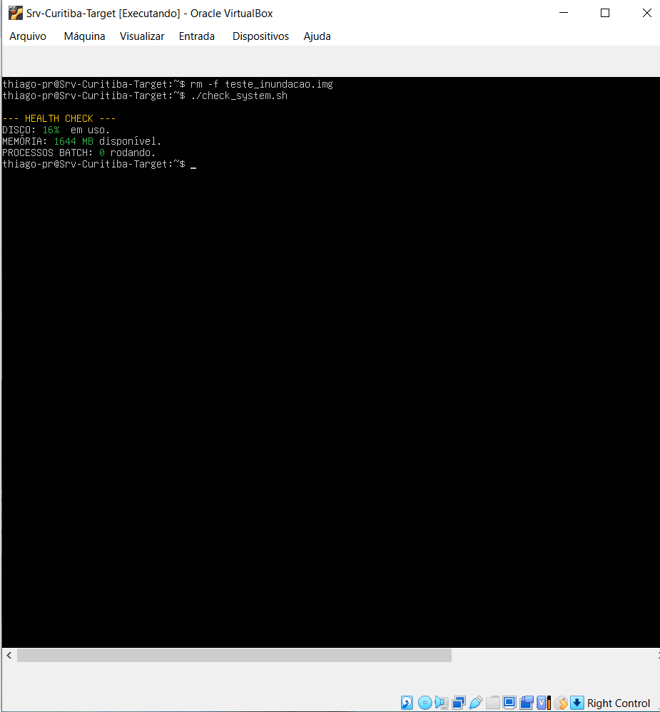
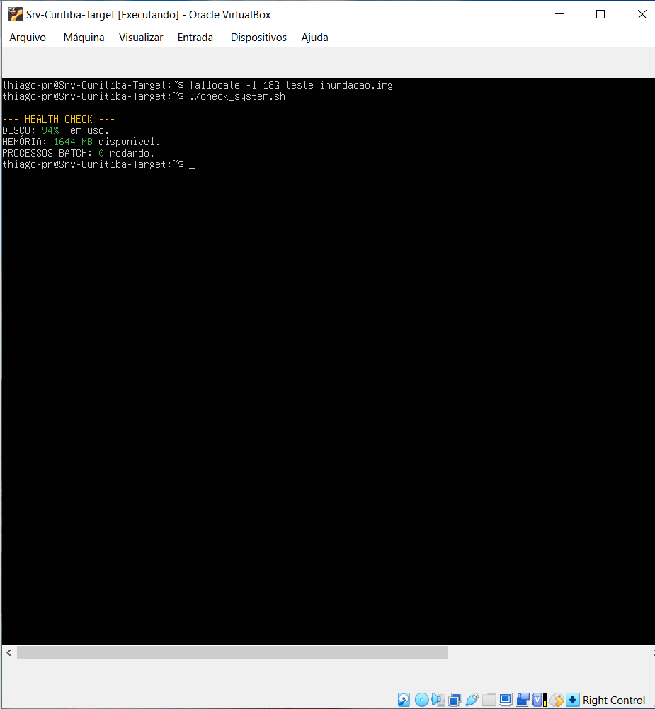
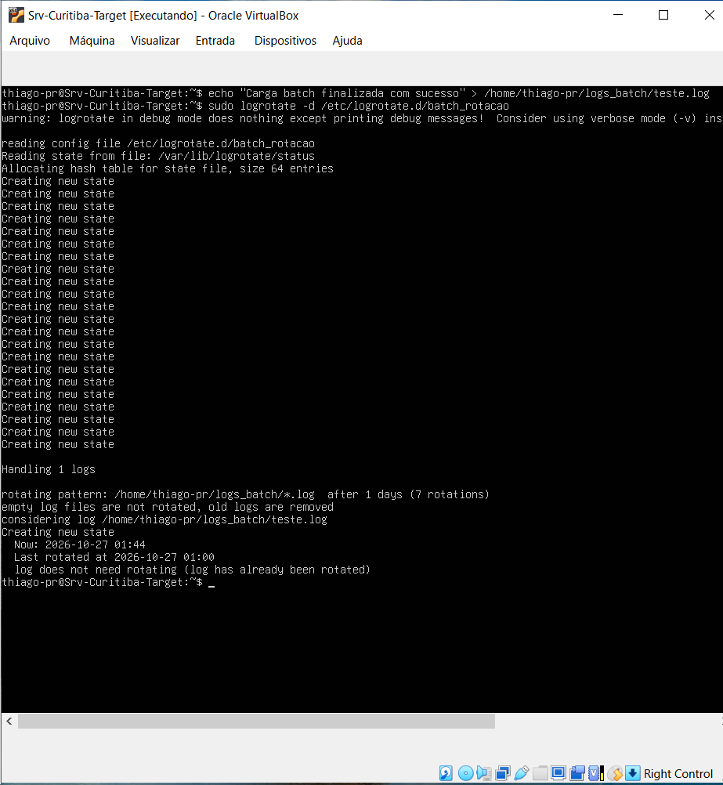
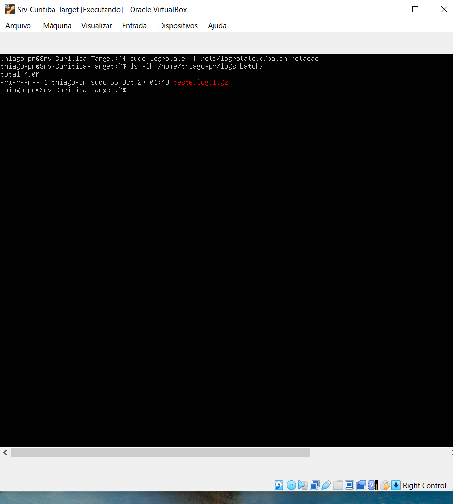

#  Centralização de Logs, Observabilidade e Monitoração Preventiva

Este projeto independente foi desenvolvido para implementar uma arquitetura completa de **Sustentação Preventiva e coleta de métricas de Ativos** em servidores Linux (Ubuntu Server). O objetivo principal é garantir a resiliência operacional do ambiente através de rotinas programadas de diagnóstico e blindagem de infraestrutura contra incidentes clássicos de exaustão de recursos.


## 🚀 Tecnologias e Conceitos Aplicados
*   **Shell Scripting (Bash):** Automação de checagem de integridade do sistema.
*   **Log Management (Logrotate):** Configuração preventiva contra estouro de disco por retenção de escrita.
*   **Troubleshooting Avançado:** Mitigação de incidentes de infraestrutura em tempo real.

---

## 🛠️ 1. Script de Monitoração (`check_system.sh`)

Desenvolvimento de um script focado em coleta de métricas rápida para o operador. O script realiza validações preventivas de:
1.  **Espaço em Disco:** Alerta caso o uso passe de 85% (risco de travamento da janela Batch).
2.  **Memória RAM:** Quantidade de memória disponível para o processamento.
3.  **Processos Duplicados:** Garante que não existam instâncias órfãs da carga `batch_exec`.

### Saída em Cenário Saudável (Green)
Quando os parâmetros estão normais, o script valida a liberação do ambiente:



### Saída em Cenário de Incidente Registrado (Red)
Simulação de uma inundação controlada de disco de **18GB** utilizando o comando `fallocate`. O script altera sua saída dinamicamente apontando o estado crítico da infraestrutura:



---

## ♻️ 2. Gerenciamento e Rotação de Logs (`Logrotate`)

Para mitigar a vulnerabilidade de inundação de disco por logs volumosos gerados pelas cargas Batch, foi criada uma regra customizada no `logrotate` do Linux localizada em `/etc/logrotate.d/batch_rotacao`:

```text
/home/thiago-pr/logs_batch/*.log {
    daily
    rotate 7
    compress
    missingok
    notifempty
}
```

### Validação Sintática (Modo Debug)
Execução do utilitário em modo de depuração para checar a consistência da árvore de diretórios e comandos:
```bash
sudo logrotate -d /etc/logrotate.d/batch_rotacao
```


### Resultado Prático de Rotação Forçada
Validação do funcionamento forçando a execução imediata (`sudo logrotate -f`). O arquivo original de log é compactado em formato `.gz` com sucesso, preservando o espaço em disco de produção:



---

## 📋 Conclusão Operacional
A arquitetura implementada consolida as melhores práticas de **SRE (Site Reliability Engineering)** e administração de sistemas Linux. O ecossistema garante previsibilidade, visibilidade de métricas essenciais e remediação rápida de falhas por meio de instrumentação de baixo nível, simulando perfeitamente os desafios e os padrões de governança exigidos em ambientes corporativos de alta criticidade.
